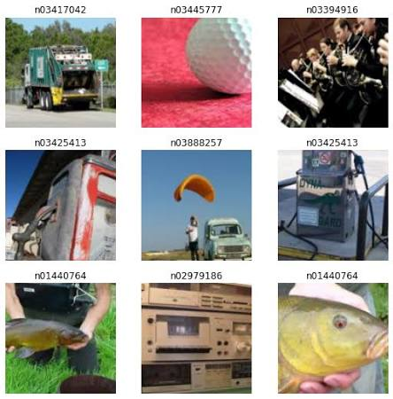
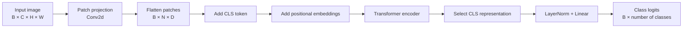
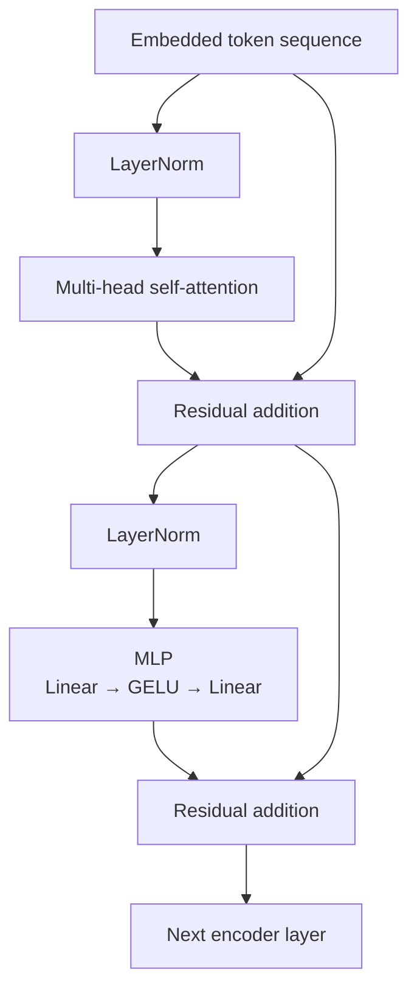
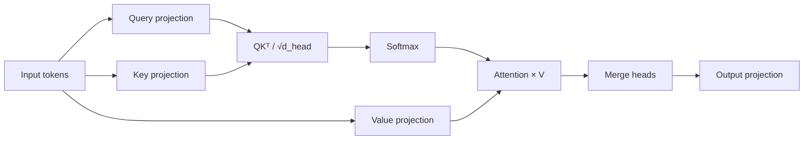
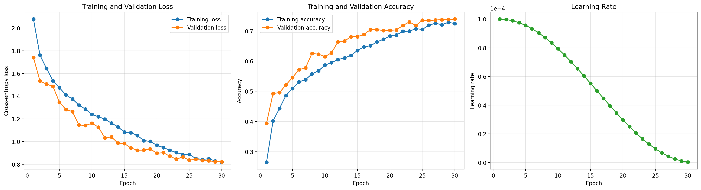

# Vision Transformer from Scratch with PyTorch

A from-scratch implementation of a **Vision Transformer (ViT)** for image classification using PyTorch. The model is trained and evaluated on the **Imagenette** dataset, a 10-class subset of ImageNet.

The project implements the core Vision Transformer components without relying on a prebuilt ViT model:

- Patch embeddings using `Conv2d`
- Learnable class token
- Learnable positional embeddings
- Multi-head self-attention
- Transformer encoder blocks
- MLP classification head
- Training and validation pipelines
- Data augmentation and ImageNet normalization
- Cosine learning-rate scheduling

<p align="center">
  
</p>

> The image above is generated by the visualization code described in
> [Generating README images](#generating-readme-images).

---

## Table of contents

- [Project overview](#project-overview)
- [Model architecture](#model-architecture)
- [Data pipeline](#data-pipeline)
- [Project structure](#project-structure)
- [Requirements](#requirements)
- [Installation](#installation)
- [Configuration](#configuration)
- [Training](#training)
- [Evaluation](#evaluation)
- [Generating README images](#generating-readme-images)
- [Implementation details](#implementation-details)
- [Important corrections](#important-corrections)
- [Limitations](#limitations)
- [Possible improvements](#possible-improvements)
- [License](#license)

---

## Project overview

A Vision Transformer converts an input image into a sequence of non-overlapping image patches. Each patch is projected into an embedding vector and processed as a token by a Transformer encoder.

For an input image with dimensions:

```text
(B, C, H, W)
```

and patch size `P`, the number of image patches is:

```text
N = (H / P) × (W / P)
```

A learnable classification token is prepended to the patch sequence, resulting in:

```text
(B, N + 1, embedding_dimension)
```

The final representation of the classification token is passed through a linear classification head.

### Processing flow



---

## Model architecture

The model uses a pre-normalization Transformer architecture. Layer normalization is applied before self-attention and before the MLP.



Each encoder block computes:

```text
x = x + Attention(LayerNorm(x))
x = x + MLP(LayerNorm(x))
```

### Multi-head self-attention

The input is projected into queries, keys, and values:

```text
Q = XWq
K = XWk
V = XWv
```

Scaled dot-product attention is then calculated as:

```text
Attention(Q, K, V) = softmax(QKᵀ / √d_head)V
```



### Tensor shapes

Assuming:

- Batch size: `B`
- Number of tokens: `T`
- Embedding dimension: `D`
- Number of attention heads: `H`
- Per-head dimension: `Dh = D / H`

The principal tensor shapes are:

| Stage | Shape |
|---|---:|
| Input image | `(B, C, image_size, image_size)` |
| Patch projection | `(B, D, patches_per_side, patches_per_side)` |
| Flattened patches | `(B, D, N)` |
| Transposed patches | `(B, N, D)` |
| CLS token | `(B, 1, D)` |
| Transformer input | `(B, N + 1, D)` |
| Query/key/value | `(B, H, N + 1, Dh)` |
| Attention matrix | `(B, H, N + 1, N + 1)` |
| Encoder output | `(B, N + 1, D)` |
| CLS representation | `(B, D)` |
| Class logits | `(B, number_of_classes)` |

The embedding dimension must be divisible by the number of attention heads:

```python
assert config.embd_dim % config.num_heads == 0
```

---

## Data pipeline

The project uses [`torchvision.datasets.Imagenette`](https://pytorch.org/vision/stable/generated/torchvision.datasets.Imagenette.html).

Imagenette contains ten easily classified ImageNet categories.

### Training transformations

The training pipeline applies:

1. Resize
2. Random resized crop
3. Random horizontal flip
4. Color jitter
5. Random rotation
6. Conversion to tensor
7. ImageNet normalization


### Validation transformations

Validation images use deterministic preprocessing:

1. Resize
2. Conversion to tensor
3. ImageNet normalization

This ensures that validation measurements are reproducible and unaffected by random data augmentation.

### ImageNet normalization

```python
mean = [0.485, 0.456, 0.406]
std = [0.229, 0.224, 0.225]
```

---

## Project structure

A recommended project structure is:

```text
src/
├── config.py
├── dataset.py
├── model.py
├── train.py
├── test.py
├── requirements.txt
├── data/
├── checkpoints/
│   └── best_model.pt
└── docs/
    └── images/
        ├── sample_images.png
        ├── tory.png
        └── predictions.png
└── README.md
```

### File responsibilities

| File | Description |
|---|---|
| `config.py` | Model, dataset, optimizer, and runtime configuration |
| `dataset.py` | Imagenette datasets, transformations, and data loaders |
| `model.py` | ViT embedding, attention, MLP, encoder, and classification model |
| `train.py` | Training and validation loops |
| `evaluate.py` | Evaluation and prediction visualization |
| `requirements.txt` | Python dependencies |
| `checkpoints/` | Saved model checkpoints |
| `docs/images/` | Images rendered in this README |

---

## Requirements

- Python 3.10 or newer
- PyTorch
- Torchvision
- NumPy
- Matplotlib
- tqdm
- torchinfo
- CUDA-compatible GPU recommended, but not required

Example `requirements.txt`:

```text
torch>=2.1
torchvision>=0.16
numpy>=1.24
matplotlib>=3.7
tqdm>=4.66
torchinfo>=1.8
Pillow>=10.0
```

---

## Installation

### 1. Clone the repository

```bash
git clone https://github.com/your-user/vision-transformer-pytorch.git
cd vision-transformer-pytorch
```

### 2. Create a virtual environment

Using `venv`:

```bash
python -m venv .venv
```

Activate it on Linux or macOS:

```bash
source .venv/bin/activate
```

Activate it on Windows PowerShell:

```powershell
.venv\Scripts\Activate.ps1
```

### 3. Install dependencies

```bash
python -m pip install --upgrade pip
pip install -r requirements.txt
```

For CUDA-specific PyTorch installation instructions, use the official
[PyTorch installation selector](https://pytorch.org/get-started/locally/).

---

## Configuration

The code expects a configuration object called `vit_config`.

A compatible `config.py` can be defined as follows:

```python
from dataclasses import dataclass, field
import torch


@dataclass
class ViTConfig:
    # Reproducibility
    random_seed: int = 42

    # Dataset
    image_size: int = 224
    num_channels: int = 3
    num_classes: int = 10
    batch_size: int = 32

    # Patch embedding
    patch_size: int = 16
    embd_dim: int = 384

    # Transformer
    num_heads: int = 6
    num_encoder_layers: int = 6
    layer_norm_eps: float = 1e-6
    dropout: float = 0.1

    # Optimization
    epochs: int = 30
    learning_rate: float = 3e-4
    adam_betas: tuple[float, float] = (0.9, 0.999)
    adam_weight_decay: float = 0.05

    # Runtime
    device: torch.device = field(
        default_factory=lambda: torch.device(
            "cuda" if torch.cuda.is_available() else "cpu"
        )
    )

    @property
    def num_patches(self) -> int:
        if self.image_size % self.patch_size != 0:
            raise ValueError(
                "image_size must be divisible by patch_size. "
                f"Received image_size={self.image_size} and "
                f"patch_size={self.patch_size}."
            )

        return (self.image_size // self.patch_size) ** 2

    def validate(self) -> None:
        if self.embd_dim % self.num_heads != 0:
            raise ValueError(
                "embd_dim must be divisible by num_heads. "
                f"Received embd_dim={self.embd_dim} and "
                f"num_heads={self.num_heads}."
            )


vit_config = ViTConfig()
vit_config.validate()
```

For `image_size=224` and `patch_size=16`:

```text
patches_per_side = 224 / 16 = 14
number_of_patches = 14 × 14 = 196
number_of_tokens = 196 + 1 CLS token = 197
```

### Suggested configurations

#### Small model

```python
embd_dim = 192
num_heads = 3
num_encoder_layers = 4
patch_size = 16
```

#### Medium model

```python
embd_dim = 384
num_heads = 6
num_encoder_layers = 6
patch_size = 16
```

#### Larger model

```python
embd_dim = 768
num_heads = 12
num_encoder_layers = 12
patch_size = 16
```

Training a larger model from scratch requires substantially more memory, time, and data.

---

## Training

Start training with:

```bash
python train.py
```

The training script:

1. Sets random seeds
2. Downloads Imagenette if necessary
3. Creates training and validation loaders
4. Builds the Vision Transformer
5. Displays the model summary
6. Trains with cross-entropy loss
7. Evaluates after every epoch
8. Updates the learning rate using cosine annealing

Example console output:

```text
Epoch 1/30
Train: 100%|██████████| 296/296 [02:18<00:00, loss=2.0124, acc=0.2815]
Valid: 100%|██████████| 123/123 [00:24<00:00, loss=1.7721, acc=0.3972]

Epoch 1/30 |
Train Loss: 2.0124 |
Train Acc: 0.2815 |
Val Loss: 1.7721 |
Val Acc: 0.3972 |
LR: 2.99e-04
```

### Saving the best checkpoint

Saving only the final model is usually less effective than saving the checkpoint with the best validation accuracy.

Add the following before the training loop:

```python
from pathlib import Path

Path("checkpoints").mkdir(parents=True, exist_ok=True)
best_val_acc = 0.0
```

Add the following after each validation epoch:

```python
if val_acc > best_val_acc:
    best_val_acc = val_acc

    torch.save(
        {
            "epoch": epoch + 1,
            "model_state_dict": model.state_dict(),
            "optimizer_state_dict": optimizer.state_dict(),
            "scheduler_state_dict": scheduler.state_dict(),
            "val_accuracy": val_acc,
            "config": vars(config),
            "classes": classes,
        },
        "checkpoints/best_model.pt",
    )

    print(f"Saved new best checkpoint with accuracy {val_acc:.4f}")
```

Saving a `state_dict` is preferred over saving the complete Python model object because it is more portable and less dependent on the original source-file layout.

### Loading a checkpoint

```python
checkpoint = torch.load(
    "checkpoints/best_model.pt",
    map_location=config.device,
    weights_only=False,
)

model.load_state_dict(checkpoint["model_state_dict"])
model.to(config.device)
model.eval()
```

---

## Evaluation

Imagenette provides official `train` and `val` splits. It does not provide a standard `test` split through `torchvision.datasets.Imagenette`.

The validation split can therefore be used for evaluation, or it can be divided into separate validation and test subsets.

### Basic evaluation loop

```python
model.eval()

correct = 0
total = 0

with torch.inference_mode():
    for batch in val_dataloader:
        images = batch["image"].to(config.device)
        labels = batch["label"].long().to(config.device)

        logits = model(images)
        predictions = logits.argmax(dim=1)

        correct += (predictions == labels).sum().item()
        total += labels.size(0)

accuracy = correct / total
print(f"Validation accuracy: {accuracy:.4f}")
```

### Prediction visualization

<p align="center">
  
</p>

A green title can be used for a correct prediction and a red title for an incorrect prediction.

```python
from pathlib import Path
import matplotlib.pyplot as plt
import torch


Path("docs/images").mkdir(parents=True, exist_ok=True)

model.eval()
batch = next(iter(val_dataloader))

images = batch["image"].to(config.device)
labels = batch["label"].long().to(config.device)

with torch.inference_mode():
    logits = model(images)
    predictions = logits.argmax(dim=1)

count = min(6, images.size(0))
fig, axes = plt.subplots(2, 3, figsize=(12, 8))
axes = axes.flatten()

for i in range(count):
    actual = labels[i].item()
    predicted = predictions[i].item()
    title_color = "green" if actual == predicted else "red"

    axes[i].imshow(denormalize(images[i]))
    axes[i].set_title(
        f"Predicted: {classes[predicted]}\n"
        f"Actual: {classes[actual]}",
        color=title_color,
    )
    axes[i].axis("off")

for i in range(count, len(axes)):
    axes[i].axis("off")

plt.tight_layout()
plt.savefig(
    "docs/images/predictions.png",
    dpi=180,
    bbox_inches="tight",
)
plt.show()
```

---

## Generating README images

Create the image directory:

```bash
mkdir -p docs/images
```

On Windows PowerShell:

```powershell
New-Item -ItemType Directory -Force docs/images
```

### Sample dataset images

Use the following code after loading the dataset:

```python
from pathlib import Path
import matplotlib.pyplot as plt


Path("docs/images").mkdir(parents=True, exist_ok=True)

fig, axes = plt.subplots(2, 3, figsize=(12, 8))
axes = axes.flatten()

for index, axis in enumerate(axes):
    sample = dataset.traindataset[index]
    image = sample["image"]
    label = sample["label"]

    axis.imshow(denormalize(image))
    axis.set_title(classes[label])
    axis.axis("off")

plt.suptitle("Imagenette training samples", fontsize=16)
plt.tight_layout()
plt.savefig(
    "docs/images/sample_images.png",
    dpi=180,
    bbox_inches="tight",
)
plt.show()
```

### Training history

Track metrics before the training loop:

```python
history = {
    "train_loss": [],
    "train_accuracy": [],
    "val_loss": [],
    "val_accuracy": [],
}
```

At the end of every epoch:

```python
history["train_loss"].append(train_loss)
history["train_accuracy"].append(train_acc)
history["val_loss"].append(val_loss)
history["val_accuracy"].append(val_acc)
```

Generate the plot after training:

```python
from pathlib import Path
import matplotlib.pyplot as plt


Path("docs/images").mkdir(parents=True, exist_ok=True)

epochs = range(1, len(history["train_loss"]) + 1)

fig, axes = plt.subplots(1, 2, figsize=(13, 5))

axes[0].plot(epochs, history["train_loss"], label="Training")
axes[0].plot(epochs, history["val_loss"], label="Validation")
axes[0].set_title("Loss")
axes[0].set_xlabel("Epoch")
axes[0].set_ylabel("Cross-entropy loss")
axes[0].grid(alpha=0.3)
axes[0].legend()

axes[1].plot(epochs, history["train_accuracy"], label="Training")
axes[1].plot(epochs, history["val_accuracy"], label="Validation")
axes[1].set_title("Accuracy")
axes[1].set_xlabel("Epoch")
axes[1].set_ylabel("Accuracy")
axes[1].grid(alpha=0.3)
axes[1].legend()

plt.tight_layout()
plt.savefig(
    "docs/images/tory.png",
    dpi=180,
    bbox_inches="tight",
)
plt.show()
```

Then include the generated figure in this README:

<p align="center">
  
</p>

---

## Implementation details

### Patch embedding

Patch extraction and projection are performed in one operation:

```python
nn.Conv2d(
    in_channels=config.num_channels,
    out_channels=config.embd_dim,
    kernel_size=config.patch_size,
    stride=config.patch_size,
    padding=0,
)
```

When the kernel size and stride equal the patch size, the convolution creates non-overlapping patches.

The result is flattened and transposed:

```python
patch_embeddings = self.patch_embedding(x).transpose(1, 2)
```

The final shape is:

```text
(batch_size, number_of_patches, embedding_dimension)
```

### Classification token

A learnable token is prepended to every patch sequence:

```python
self.cls_token = nn.Parameter(
    torch.randn(1, 1, config.embd_dim)
)
```

It is expanded for the current batch:

```python
cls_token = self.cls_token.expand(x.size(0), -1, -1)
```

After the encoder, only its representation is passed to the classifier:

```python
x = x[:, 0, :]
```

### Positional embeddings

Self-attention alone is permutation invariant. Learnable positional embeddings allow the model to retain information about patch positions:

```python
self.pos_embeddings = nn.Parameter(
    torch.randn(
        1,
        config.num_patches + 1,
        config.embd_dim,
    )
)
```

Because the positional embedding size is fixed, inference images must normally use the same resolution as training unless positional embeddings are interpolated.

### MLP block

The current MLP expands the hidden dimension by a factor of three:

```text
D → 3D → D
```

Its activation function is GELU:

```python
F.gelu(x, approximate="tanh")
```

A factor of four is also common in standard Transformer implementations.

---

## Important corrections

The following changes should be applied to the provided source code.

### 1. Use `torch.long` labels

`nn.CrossEntropyLoss` expects class-index targets with the `torch.long` data type.

Replace:

```python
label = image["label"].type(torch.uint8).to(config.device)
```

with:

```python
label = image["label"].long().to(config.device)
```

Apply this change in both training and validation.

### 2. Imagenette has no `test` split

The following is not a supported official Imagenette split:

```python
Imagenette(root=root_dir, split="test")
```

Additionally, `self.testdataset` is commented out, while `test_loader()` still accesses it. Calling `data.test_loader()` therefore raises an `AttributeError`.

Remove the test loader or create a custom test subset from the validation data.

For example:

```python
from torch.utils.data import random_split

generator = torch.Generator().manual_seed(42)

val_size = int(0.5 * len(full_validation_dataset))
test_size = len(full_validation_dataset) - val_size

validation_dataset, test_dataset = random_split(
    full_validation_dataset,
    [val_size, test_size],
    generator=generator,
)
```

For strict evaluation, make sure both subsets use deterministic transformations.

### 3. Pass a configuration instance to the model

Prefer:

```python
class VisionTransformer(nn.Module):
    def __init__(self, config):
        super().__init__()
```

instead of:

```python
def __init__(self, config=vit_config):
```

Then instantiate explicitly:

```python
model = VisionTransformer(vit_config)
```

This avoids ambiguity over whether `vit_config` is a class or an instance.

### 4. Initialize the output after transpose safely

The attention output can be written as:

```python
attn_out = (
    attn_score @ value
).transpose(1, 2).contiguous().view(B, T, C)
```

Calling `contiguous()` immediately after `transpose()` makes the intended memory layout explicit.

### 5. Add attention-weight dropout

The current implementation applies dropout only after output projection. Standard Transformer attention usually also applies dropout to the attention probabilities:

```python
attn_score = F.softmax(attn_score, dim=-1)
attn_score = F.dropout(
    attn_score,
    p=self.dropout,
    training=self.training,
)
```

### 6. Add dropout to the MLP

The MLP currently has no dropout. A common version is:

```python
class VisionMLP(nn.Module):
    def __init__(self, config):
        super().__init__()

        hidden_dim = 4 * config.embd_dim

        self.layers = nn.Sequential(
            nn.Linear(config.embd_dim, hidden_dim),
            nn.GELU(approximate="tanh"),
            nn.Dropout(config.dropout),
            nn.Linear(hidden_dim, config.embd_dim),
            nn.Dropout(config.dropout),
        )

    def forward(self, x):
        return self.layers(x)
```

### 7. Avoid contradictory cuDNN settings

The provided code sets:

```python
torch.backends.cudnn.deterministic = True
torch.backends.cudnn.benchmark = True
```

For reproducibility, use:

```python
torch.backends.cudnn.deterministic = True
torch.backends.cudnn.benchmark = False
```

For maximum performance with fixed input shapes, use:

```python
torch.backends.cudnn.deterministic = False
torch.backends.cudnn.benchmark = True
```

Exact reproducibility can still depend on the hardware, PyTorch version, and CUDA operations.

### 8. Remove redundant resize from training augmentation

The training pipeline currently resizes the image before applying `RandomResizedCrop`:

```python
transforms.Resize((image_size, image_size)),
transforms.RandomResizedCrop(image_size),
```

`RandomResizedCrop` already produces the requested output size. The pipeline can be simplified to:

```python
transforms.Compose([
    transforms.RandomResizedCrop(image_size),
    transforms.RandomHorizontalFlip(),
    transforms.ColorJitter(
        brightness=0.4,
        contrast=0.4,
        saturation=0.4,
    ),
    transforms.RandomRotation(15),
    transforms.ToTensor(),
    transforms.Normalize(
        mean=[0.485, 0.456, 0.406],
        std=[0.229, 0.224, 0.225],
    ),
])
```

### 9. Improve validation resizing

Directly resizing an image to a square can distort its aspect ratio:

```python
transforms.Resize((image_size, image_size))
```

A more conventional validation pipeline is:

```python
transforms.Compose([
    transforms.Resize(int(image_size * 256 / 224)),
    transforms.CenterCrop(image_size),
    transforms.ToTensor(),
    transforms.Normalize(
        mean=[0.485, 0.456, 0.406],
        std=[0.229, 0.224, 0.225],
    ),
])
```

### 10. Improve DataLoader performance

When using CUDA, consider:

```python
DataLoader(
    dataset,
    batch_size=batch_size,
    shuffle=True,
    num_workers=4,
    pin_memory=True,
    persistent_workers=True,
)
```

Transfer tensors using:

```python
images = batch["image"].to(
    config.device,
    non_blocking=True,
)
```

Set `persistent_workers=True` only when `num_workers > 0`.

---

## Limitations

- The model is trained from scratch on a relatively small dataset.
- Learnable positional embeddings assume a fixed input resolution.
- The implementation does not currently support mixed-precision training.
- No attention-mask support is included.
- There is no stochastic depth or layer-scale regularization.
- The original training script does not save checkpoints automatically.
- Imagenette has only official training and validation splits.
- Aggressive augmentation may reduce performance if the training schedule is short.
- A Vision Transformer may converge more slowly than a CNN when trained from scratch on limited data.

---

## Possible improvements

Potential extensions include:

- Automatic mixed precision with `torch.autocast`
- Gradient scaling with `torch.amp.GradScaler`
- Gradient clipping
- Warmup followed by cosine decay
- AdamW instead of Adam
- Label smoothing
- Mixup and CutMix
- RandAugment
- Stochastic depth
- Early stopping
- TensorBoard or Weights & Biases logging
- Confusion matrix generation
- Per-class precision, recall, and F1 score
- Attention-map visualization
- Positional embedding interpolation
- Model export to ONNX
- PyTorch compilation with `torch.compile`
- Distributed training
- Pretraining on a larger dataset followed by fine-tuning

### Suggested optimizer

For Transformer training, `AdamW` is generally preferred:

```python
optimizer = torch.optim.AdamW(
    model.parameters(),
    lr=config.learning_rate,
    betas=config.adam_betas,
    weight_decay=config.adam_weight_decay,
)
```

### Label smoothing

```python
criterion = nn.CrossEntropyLoss(label_smoothing=0.1)
```

### Mixed-precision training

```python
scaler = torch.amp.GradScaler(
    "cuda",
    enabled=config.device.type == "cuda",
)

optimizer.zero_grad(set_to_none=True)

with torch.autocast(
    device_type=config.device.type,
    dtype=torch.float16,
    enabled=config.device.type == "cuda",
):
    logits = model(images)
    loss = criterion(logits, labels)

scaler.scale(loss).backward()
scaler.step(optimizer)
scaler.update()
```

---

## License

Add the license used by your project here.

For example:

```text
This project is licensed under the MIT License.
```

---

## Acknowledgements

- [An Image is Worth 16×16 Words: Transformers for Image Recognition at Scale](https://arxiv.org/abs/2010.11929)
- [PyTorch](https://pytorch.org/)
- [Torchvision Imagenette](https://pytorch.org/vision/stable/generated/torchvision.datasets.Imagenette.html)
- [Imagenette by fast.ai](https://github.com/fastai/imagenette)
