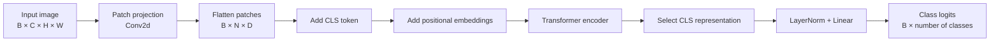
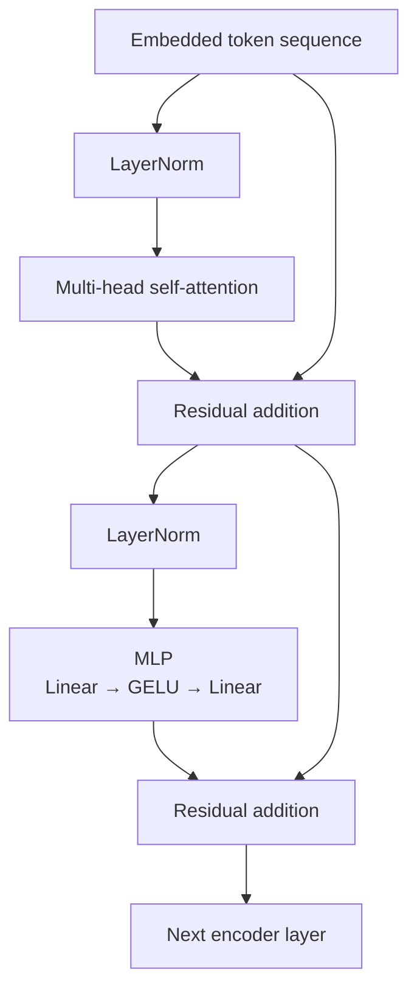
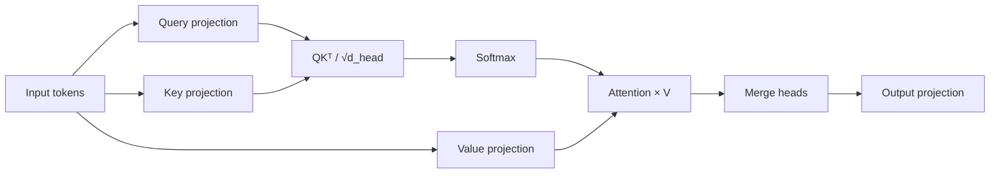
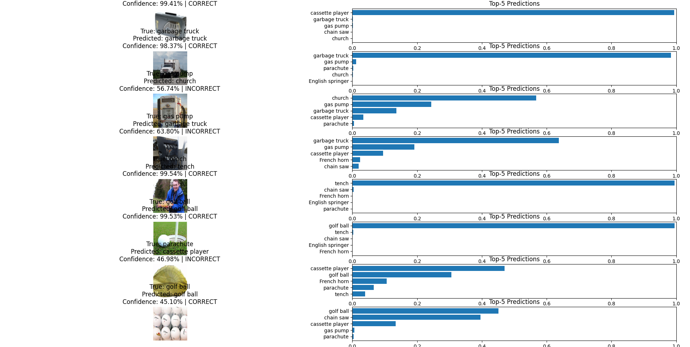

# Vision Transformer from Scratch with PyTorch

A from-scratch implementation of a **Vision Transformer (ViT)** for image classification using PyTorch. The model is trained and evaluated on **Imagenette**, a 10-class subset of ImageNet.

<p align="center">
  
</p>

## Table of Contents

- [Overview](#overview)
- [Project Overview](#project-overview)
  - [Processing Flow](#processing-flow)
- [Model Architecture](#model-architecture)
  - [Multi-Head Self-Attention](#multi-head-self-attention)
  - [Tensor Shapes](#tensor-shapes)
- [Data Pipeline](#data-pipeline)
  - [Training Transformations](#training-transformations)
  - [Validation Transformations](#validation-transformations)
  - [ImageNet Normalization](#imagenet-normalization)
- [Project Structure](#project-structure)
- [Installation](#installation)
- [Configuration](#configuration)
- [Training](#training)
- [Evaluation and Predictions](#evaluation-and-predictions)
- [Results](#results)
- [Future Improvements](#future-improvements)
- [Acknowledgements](#acknowledgements)
- [License](#license)
- [Contributing](#contributing)
---

## Overview

Vision Transformers apply the Transformer architecture to images by dividing them into patches and processing them as a sequence of tokens.

This project implements the core ViT components from scratch:

- Patch embeddings using `Conv2d`
- Learnable classification and positional embeddings
- Multi-head self-attention
- Transformer encoder blocks with residual connections
- MLP classification head
- Training and validation pipelines
- Data augmentation and learning-rate scheduling

## Project overview

A Vision Transformer converts an input image into a sequence of non-overlapping image patches. Each patch is projected into an embedding vector and processed as a token by a Transformer encoder.

For an input image with dimensions:

```text
(B, C, H, W)
```

and patch size `P`, the number of image patches is:

```text
N = (H / P) × (W / P)
```

A learnable classification token is prepended to the patch sequence, resulting in:

```text
(B, N + 1, embedding_dimension)
```

The final representation of the classification token is passed through a linear classification head.

### Processing flow



---

## Model architecture

The model uses a pre-normalization Transformer architecture. Layer normalization is applied before self-attention and before the MLP.



Each encoder block computes:

```text
x = x + Attention(LayerNorm(x))
x = x + MLP(LayerNorm(x))
```

### Multi-head self-attention

The input is projected into queries, keys, and values:

```text
Q = XWq
K = XWk
V = XWv
```

Scaled dot-product attention is then calculated as:

```text
Attention(Q, K, V) = softmax(QKᵀ / √d_head)V
```



### Tensor shapes

Assuming:

- Batch size: `B`
- Number of tokens: `T`
- Embedding dimension: `D`
- Number of attention heads: `H`
- Per-head dimension: `Dh = D / H`

The principal tensor shapes are:

| Stage | Shape |
|---|---:|
| Input image | `(B, C, image_size, image_size)` |
| Patch projection | `(B, D, patches_per_side, patches_per_side)` |
| Flattened patches | `(B, D, N)` |
| Transposed patches | `(B, N, D)` |
| CLS token | `(B, 1, D)` |
| Transformer input | `(B, N + 1, D)` |
| Query/key/value | `(B, H, N + 1, Dh)` |
| Attention matrix | `(B, H, N + 1, N + 1)` |
| Encoder output | `(B, N + 1, D)` |
| CLS representation | `(B, D)` |
| Class logits | `(B, number_of_classes)` |

The embedding dimension must be divisible by the number of attention heads:

```python
assert config.embd_dim % config.num_heads == 0
```

---

## Data pipeline

The project uses [`torchvision.datasets.Imagenette`](https://pytorch.org/vision/stable/generated/torchvision.datasets.Imagenette.html).

Imagenette contains ten easily classified ImageNet categories.

### Training transformations

The training pipeline applies:

1. Resize
2. Random resized crop
3. Random horizontal flip
4. Color jitter
5. Random rotation
6. Conversion to tensor
7. ImageNet normalization


### Validation transformations

Validation images use deterministic preprocessing:

1. Resize
2. Conversion to tensor
3. ImageNet normalization

This ensures that validation measurements are reproducible and unaffected by random data augmentation.

### ImageNet normalization

```python
mean = [0.485, 0.456, 0.406]
std = [0.229, 0.224, 0.225]
```

---

## Project Structure

```text
Vision_Transformer/
├── src/
│   ├── config.py
│   ├── dataset.py
│   ├── model.py
│   ├── train.py
│   ├── test.py
│   └── docs/
│       └── images/
├── outputs/
│   ├── checkpoints/
│   │   └── best_model.pt
│   └── history/
│       └── train_history.json
├── requirements.txt
└── README.md
```

| File | Purpose |
|---|---|
| `config.py` | Model and training configuration |
| `dataset.py` | Dataset loading and preprocessing |
| `model.py` | Vision Transformer implementation |
| `train.py` | Training and validation |
| `test.py` | Inference and prediction visualization |
| `outputs/` | Saved checkpoints and training history |

## Installation

**Requirements:** Python 3.10+, PyTorch, Torchvision, NumPy, Matplotlib, Pillow, and tqdm. A CUDA-compatible GPU is recommended but not required.

Clone the repository and install its dependencies:

```bash
git clone https://github.com/your-user/vision-transformer-pytorch.git
cd vision-transformer-pytorch

python -m venv .venv
```

Activate the environment on Windows:

```powershell
.venv\Scripts\Activate.ps1
```

Install dependencies:

```bash
pip install -r requirements.txt
```

Install the appropriate PyTorch build for your hardware using the [official installation guide](https://pytorch.org/get-started/locally/).

## Configuration

The model and training settings are managed through `vit_config` in `config.py`.

| Parameter | Example value |
|---|---:|
| Image size | 224 |
| Patch size | 16 |
| Embedding dimension | 384 |
| Attention heads | 6 |
| Encoder layers | 6 |
| Number of classes | 10 |
| Batch size | 32 |
| Training epochs | 30 |
| Learning rate | 0.0003 |

These are example settings; your actual configuration may differ.

## Training

Run the training script from the project root:

```bash
python src/train.py
```

The training pipeline loads Imagenette, initializes the model, optimizes the classification loss, evaluates validation performance after each epoch, and uses cosine learning-rate scheduling.

The best checkpoint is saved at:

```text
outputs/checkpoints/best_model.pt
```

Training history is stored in `outputs/history/train_history.json`.

## Evaluation and Predictions

Run inference on randomly selected validation images:

```bash
python src/test.py
```

The script loads the trained checkpoint and displays sample validation images alongside:

- Ground-truth labels
- Predicted classes
- Prediction confidence
- Top-5 class probabilities

<p align="center">
  
</p>

## Results

The current checkpoint achieved a **validation accuracy of 73.94%** after 30 epochs.

| Metric | Result |
|---|---:|
| Training epochs | 30 |
| Number of classes | 10 |
| Validation accuracy | 73.94% |

The reported accuracy is from the saved checkpoint. Results may vary depending on model configuration, random initialization, augmentation, and training settings.

## Future Improvements

Possible extensions include:

- Mixed-precision training
- AdamW optimization and learning-rate warmup
- Mixup and CutMix augmentation
- Confusion matrix and per-class metrics
- Attention-map visualization
- TensorBoard or Weights & Biases logging
- Pretraining and fine-tuning on larger datasets

## Acknowledgements

- [An Image Is Worth 16×16 Words: Transformers for Image Recognition at Scale](https://arxiv.org/abs/2010.11929)
- [PyTorch](https://pytorch.org/)
- [Torchvision](https://pytorch.org/vision/stable/index.html)
- [Imagenette](https://github.com/fastai/imagenette)

## License

MIT License

Copyright (c) 2026 Melvin Paul Jacob

Permission is hereby granted, free of charge, to any person obtaining a copy
of this software and associated documentation files (the "Software"), to deal
in the Software without restriction, including without limitation the rights
to use, copy, modify, merge, publish, distribute, sublicense, and/or sell
copies of the Software, and to permit persons to whom the Software is
furnished to do so, subject to the following conditions:

The above copyright notice and this permission notice shall be included in all
copies or substantial portions of the Software.

THE SOFTWARE IS PROVIDED "AS IS", WITHOUT WARRANTY OF ANY KIND, EXPRESS OR
IMPLIED, INCLUDING BUT NOT LIMITED TO THE WARRANTIES OF MERCHANTABILITY,
FITNESS FOR A PARTICULAR PURPOSE AND NONINFRINGEMENT. IN NO EVENT SHALL THE
AUTHORS OR COPYRIGHT HOLDERS BE LIABLE FOR ANY CLAIM, DAMAGES OR OTHER
LIABILITY, WHETHER IN AN ACTION OF CONTRACT, TORT OR OTHERWISE, ARISING FROM,
OUT OF OR IN CONNECTION WITH THE SOFTWARE OR THE USE OR OTHER DEALINGS IN THE
SOFTWARE.

## Contributing

Contributions are welcome! If you would like to improve this project, fix a bug, optimize the model, or add new features, feel free to contribute.

1. Fork this repository.
2. Create a new branch for your changes.
3. Make your changes and test them.
4. Submit a pull request with a clear description of your improvements.

Please keep contributions clean, well-documented, and focused on improving the project.

By submitting a contribution, you agree that it may be distributed under the project's MIT License.

If you find a bug or have an idea for improvement, feel free to open an issue.

**Let's learn, build, and improve together!**
